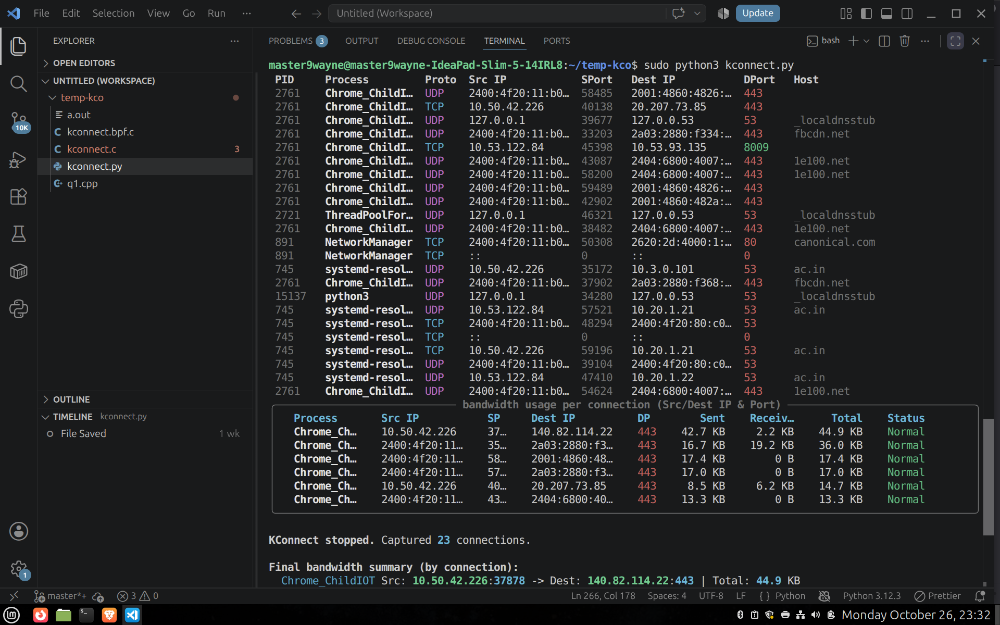
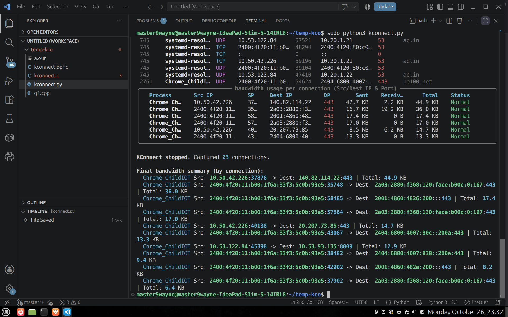

# KConnect
### An eBPF-Based, Process-Aware Network Monitor

KConnect is an eBPF-based network monitoring tool that maps network connections to the processes that create them. By attaching to kernel-level network events, it provides visibility into the IP addresses, ports, and protocols used by individual processes.

It helps developers and system administrators debug networking issues, investigate unexpected connections, and understand system-wide network activity.

## Features

- **Process-Aware Monitoring:** Identify processes associated with network connections using PIDs.
- **Connection Tracking:** Monitor IP addresses, ports, and network protocols.
- **Per-Process Statistics:** View network activity grouped by individual processes.
- **System-Wide Overview:** Get a high-level view of network activity across processes.
- **Kernel-Level Visibility:** Leverage eBPF to observe network events efficiently.

## Screenshots

### Per-Process Statistics

View network activity and connection statistics for individual processes.

### Network Overview

Get an overview of network connections and activity across the system.

## Motivation

Traditional network monitoring tools often show network connections without providing a convenient process-level view. KConnect bridges this gap by correlating kernel-level network events with process information, making it easier to investigate unexpected connections and understand application network behavior.

## Use Cases

- Debugging application networking issues
- Investigating unexpected outbound connections
- Monitoring process-level network activity
- Exploring Linux networking and eBPF internals

